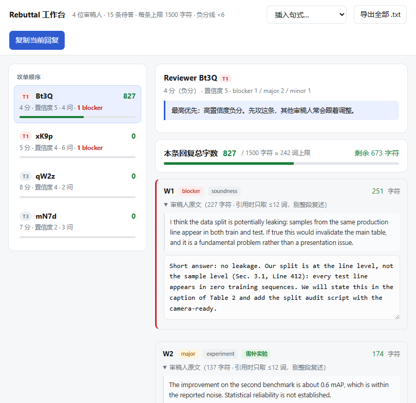

<div align="center">

# CCFA-Rebuttal-Skill

**Turn a pile of reviewer comments into a rebuttal that fits the character budget and reads to the AC as "concern resolved".**

[](skills/ccfa-rebuttal/SKILL.md)
[](LICENSE)
[](#-contributing)
[](skills/ccfa-rebuttal/scripts)
[](README.md)
[](README.en.md)

[**中文**](README.md) · **English**

</div>

---

## What problem it actually solves

When reviews land, the hard part is usually not English. It is four concrete decisions:

| Pain point | What people do | What this skill does |
| --- | --- | --- |
| 4 reviewers, 15 points, 1,500 characters each | Spread effort evenly, run out of budget on reviewer #2 | A script ranks the **attack order** (high-confidence negative → borderline → hold-the-positive) and tracks remaining characters live |
| "Novelty is limited" — now what | Explain for three paragraphs, still no conclusion | A playbook of 14 objection types, each with *signal → triage → tactic → an English exemplar you can edit* |
| Am I even allowed to add experiments? | Guess, or ask a WeChat group | A **searchable venue rule library** where every line is tagged ✅ official / 🟡 community experience / ❓ verify against this year's CFP |
| The LLM "helpfully" invented an ablation | — | Three hard rules + a tense-consistency table: anything not actually run must stay as `[evidence needed]` |

> **Positioning**: this is not a rebuttal template collection. It is a workflow installed into your AI assistant — from parsing reviews to exporting text you can paste.

---

## Preview

The interactive workbench (single local HTML file, no network, drafts stay in your browser):



Reviewers on the left in attack order, drafting in the middle, **live character count that turns red and says "cannot submit" when you exceed the limit**.

---

## Quick start

### 1. Install the skill

Any of these (Node.js ≥ 18 required):

```bash
# Option A: skills CLI (recommended; works for Claude Code / Codex)
npx skills add codeocd/CCFA-rebuttal-skill --skill ccfa-rebuttal

# Option B: manual copy for Claude Code
git clone https://github.com/codeocd/CCFA-rebuttal-skill.git
cp -R CCFA-rebuttal-skill/skills/ccfa-rebuttal ~/.claude/skills/

# Option C: Qoder (project scope)
cp -R CCFA-rebuttal-skill/skills/ccfa-rebuttal .qoder/skills/
```

> ⚠️ **Copy the whole directory**, not just `SKILL.md` — it lazily loads the strategy library, phrase bank and venue cards from `references/`.

Restart the session (or `/skills reload`), then just talk:

```
Help me write a rebuttal, here are 4 reviews: [paste]
```

### 2. Or run the scripts standalone (no install needed)

```bash
node skills/ccfa-rebuttal/scripts/parse_reviews.mjs reviews.txt \
     --out rebuttal-workspace --limit 1500 --threshold 6

node skills/ccfa-rebuttal/scripts/build_workbench.mjs rebuttal-workspace
open rebuttal-workspace/workbench.html
```

Output:

```
✅ parsed 4 reviewers / 15 points to answer
   2 negative · 8 needing new numbers · 3 shared concerns
   attack order: Bt3Q(T1,4) → xK9p(T1,5) → qW2z(T3,8) → mN7d(T3,7)
```

Before submitting, verify the budget:

```bash
node skills/ccfa-rebuttal/scripts/parse_reviews.mjs --check rebuttal-workspace

Bt3Q.md — 1055/1500 ✅ · 4/4 filled
xK9p.md — 1339/1500 ✅ · 6/6 filled
```

👉 A complete runnable example lives in **[examples/aaai27-demo/](examples/aaai27-demo/)**: `reviews.txt` (synthetic) → `workspace/` (parsed) → **[final-rebuttal.md](examples/aaai27-demo/final-rebuttal.md)** (finished text plus why the effort was allocated that way).

---

## What you get

| Capability | Detail |
| --- | --- |
| **Review parsing** | Splits reviewers, extracts score/confidence, numbers every W/Q, and detects explicit "I would raise my score if…" conditions |
| **Attack order** | Ranks reviewers and assigns a writing budget to each |
| **Shared-concern clustering** | Concerns raised by ≥2 reviewers are merged into one section so you stop paying for repetition |
| **14 objection playbooks** | novelty, baseline, experiment, theory, scalability, reproducibility, clarity, limitation, soundness, ethics, vague reviews, hostile reviews, infeasible experiments, out-of-scope asks |
| **English phrase bank** | Openers, conclusion-first, pointing to existing evidence, polite disagreement, owning presentation issues, making promises verifiable, one-line results, asking for specifics, closers, confidential comments to the AC |
| **Venue rule library** | AAAI, NeurIPS, ICLR, ICML, CVPR/ICCV/ECCV, ACL/EMNLP (ARR), IJCAI — character limits, new-experiment policy, external links, reviewer visibility, score-change base rates |
| **Character counting** | Counts the way OpenReview does (`apple` = 5; spaces and Markdown syntax are billed too), not a word estimate |
| **Interactive workbench** | Single HTML file: live counts, over-limit alerts, snippet insertion, local drafts, one-click plain-text export |
| **Anti-pattern checklist** | 17 score-losing moves, a 7-step order for cutting when you are over budget, and a 60-second pre-submit checklist |

---

## How it is structured

Three-tier progressive disclosure, so the whole methodology never has to sit in context at once:

```
skills/ccfa-rebuttal/
├── SKILL.md                      main workflow, tense consistency, output protocol
├── references/
│   ├── strategy.md               who really reads it, attack order, budget, what to concede, when to write to the AC, base rates
│   ├── objection-playbook.md     14 objection types → triage + tactic + exemplar
│   ├── phrasebank.md             English sentences + banned hedges
│   ├── pitfalls.md               anti-patterns, format traps, cut order, final checklist
│   └── conferences/              greppable, extensible venue cards
│       ├── index.md              routing table: which rebuttal format are you in?
│       ├── aaai.md  neurips.md  iclr.md  icml.md  cvpr.md  acl.md
│       └── _TEMPLATE.md          your venue missing? copy it and paste the CFP text
├── scripts/
│   ├── parse_reviews.mjs         parse + ranking + budget (--check)
│   └── build_workbench.mjs       inject workspace.json into the HTML workbench
└── assets/
    └── workbench.html            workbench template
```

**Output language**: rebuttal text in English; strategic commentary in Chinese.

> 📌 **A note on language.** The instruction files are currently written in Chinese because they were built for the CCF-A author community, where most rebuttal panic happens. The rebuttal output itself is English. A full English translation of `SKILL.md` and `references/` is the single most valuable contribution anyone could make — see [Contributing](#-contributing).

---

## Three hard rules

The skill **refuses** to generate a sentence that breaks any of these, rather than quietly rewriting it into something that looks safe:

1. **No fabrication.** Experiments not run, seed counts and p-values you do not have stay as `[evidence needed]`.
2. **No lying in tense.** `We ran ...` (done) and `We will add ...` (promised) are never mixed; an assistant suggestion is not an author fact.
3. **No unverifiable promises.** `We will revise Sec. 3` is banned; it must become `We will move Sec. 3.1 to Related Work and add this paragraph: "..."`.

The reasoning is practical: with only one rebuttal round, reviewers and ACs fear *uncontrollable* revisions — and being caught once having written "planned" as "done" costs far more than this one paper.

---

## Where the content comes from

Distilled from first-hand experience write-ups, each item attributed and confidence-tagged:

- **魏秀参, "浅谈学术论文 rebuttal"** — rebuttal as a single board game, the objection taxonomy, CVPR 2019 score-change base rates (>15,000 reviews)
- **丁霄汉, "顶会 rebuttal 技术浅谈：站着，还把论文中了"** — anti-sycophancy, making promises verifiable, the three rules for writing to the AC
- **李正华, "如何做审稿意见的辩驳"** — when to escalate, how to get a reviewer to triage their own concerns
- **叶茫, "学术论文投稿与返修（Rebuttal）分享"** — the three rebuttal formats, how to treat positive vs. negative reviewers
- **吴迪, 9-point NeurIPS rebuttal strategy** — persuade the AC not the reviewer, answer by scope rather than defence, reframe novelty
- **An AAAI-27 author community digest** — first-hand: the 1,500-character hard limit, the conflicting new-experiment policy, the AI-review reply debate
- Structural inspiration from **[MLNLP-World/Paper-Rebuttal-Tips](https://github.com/MLNLP-World/Paper-Rebuttal-Tips)** and **[zhang-haichao/CS-Rebuttal-Skill](https://github.com/zhang-haichao/CS-Rebuttal-Skill)**

Anything tagged ❓ in the venue cards is a line where community accounts **contradict each other** or the rule **changes yearly** — the skill tells you to check this year's CFP instead of deciding for you. That is a design choice, not a gap.

---

## ⚠️ Disclaimer

- This is a **writing aid**, not an authority on conference policy. Character limits, new-experiment rules and link policies **change every year** — defer to the current CFP and the author notification email.
- **Authors carry the academic responsibility** for everything submitted. The tool does not run your experiments and does not decide which limitation to concede.
- The paper, reviews and all numbers under `examples/` are **synthetic** and do not correspond to any real submission.

---

## 🌟 Contributing

The main goal is to **complete the venue rule library**. Three easy ways in:

1. **Add a venue card.** Copy [`references/conferences/_TEMPLATE.md`](skills/ccfa-rebuttal/references/conferences/_TEMPLATE.md), fill in the venue you submitted to this year, and **paste the actual CFP sentence into the last section**. Leave a box ❓ rather than filling it from memory.
2. **Add an objection pattern.** Extend `objection-playbook.md` with the four-part shape: signal → triage → tactic → English exemplar.
3. **Report a parsing failure.** Attach a redacted `reviews.txt` and say what came out wrong. Review formats vary enormously; these issues are the most useful kind.

Please open an issue before writing a PR so effort is not wasted.

**Translation help is explicitly welcome** — an English `SKILL.md` + `references/` set is the highest-impact contribution available.

## 📄 License

[MIT](LICENSE)

---

<div align="center">

**If this got you through one rebuttal week, star it so the next person finds it too.**

Forking to add a rule card for your own subfield is the fastest way to make this thing actually useful to everyone.

</div>
