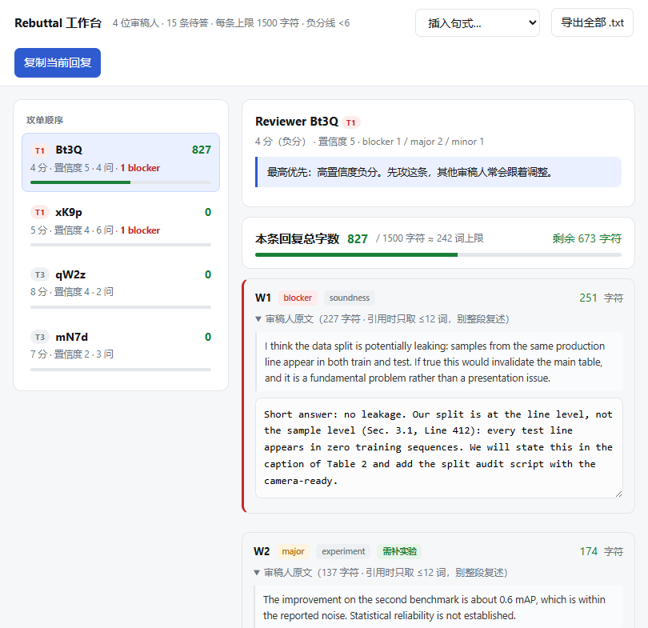

<div align="center">

# CCFA-Rebuttal-Skill

**把一堆审稿意见，变成一份在字符预算内、让 AC 一眼判定「疑虑已解决」的 rebuttal。**

[](skills/ccfa-rebuttal/SKILL.md)
[](LICENSE)
[](#-贡献)
[](skills/ccfa-rebuttal/scripts)
[](README.md)
[](README.en.md)

**中文** · [**English**](README.en.md)

</div>

---

## 30 秒看懂它解决什么

审稿意见下来，你面对的不是「会不会写英文」，而是四个具体问题：

| 痛点 | 一般做法 | 这个 skill |
| --- | --- | --- |
| 4 位审稿人、15 条问题、每条 1500 字符 | 平均用力，写到第 2 位就超了 | 脚本先排**攻单顺序**，按「高置信度负分 → borderline → 守分」分配预算，实时告诉你还剩多少字符 |
| 「novelty limited」到底怎么回 | 解释三段，还是没给结论 | 14 类异议打法库，每类给「识别信号 → 先判断 → 打法 → 可直接改写的英文范例」 |
| 不知道能不能补实验 | 凭印象，或者问群 | **可检索的会议规则库**，每条规则标注可信度（✅ 官方 / 🟡 经验 / ❓ 必须自己核对） |
| 大模型帮你「完善」了实验数据 | — | 三条铁律 + 时态一致性表：没跑过的只能写 `[待补证据]`，**拒绝生成假数字** |

> **一句话定位**：它不是 rebuttal 模板合集，是一个装进 AI 助手的**工作流**——从解析 review 到导出可粘贴的定稿。

---

## 界面长这样

交互式 rebuttal 工作台（纯本地 HTML，不联网，草稿存浏览器）：



左侧按攻单顺序列审稿人，中间逐条撰写，**字符数实时计数、超限变红并提示「无法提交」**。

---

## 快速开始

### 1. 安装 skill

任选一种（都需要 Node.js ≥ 18）：

```bash
# 方式 A：手动复制（最稳，推荐）
git clone https://github.com/codeocd/CCFA-rebuttal-skill.git
cp -R CCFA-rebuttal-skill/skills/ccfa-rebuttal ~/.claude/skills/     # Claude Code
# cp -R CCFA-rebuttal-skill/skills/ccfa-rebuttal ~/.agents/skills/   # Codex
# cp -R CCFA-rebuttal-skill/skills/ccfa-rebuttal .qoder/skills/      # Qoder（项目级）

# 方式 B：skills CLI（第三方工具，本仓库未逐版本验证；失败就回方式 A）
npx skills add codeocd/CCFA-rebuttal-skill --skill ccfa-rebuttal
```

> ⚠️ **请复制整个目录**，不要只拿 `SKILL.md`——它会按需加载 `references/` 里的策略库、句式库和会议规则卡。
>
> 仓库根目录的 `.claude-plugin/` 是 Claude Code 插件市场清单（**实验性，未经官方安装流程验证**）。上面两条安装路径不依赖它。

装好后重启会话（或 `/skills reload`），然后直接说话就能触发：

```
帮我写 rebuttal，这是 4 条 review：[粘贴]
```

### 2. 或者只跑脚本（不装 skill 也能用）

```bash
node skills/ccfa-rebuttal/scripts/parse_reviews.mjs reviews.txt \
     --out rebuttal-workspace --limit 1500 --threshold 6

node skills/ccfa-rebuttal/scripts/build_workbench.mjs rebuttal-workspace
# 打开生成的 HTML：macOS 用 open，Windows 用 start，Linux 用 xdg-open
start rebuttal-workspace\workbench.html
```

输出：

```
✅ 已解析 4 位审稿人 / 15 条待答问题
   负分 2 位 · 需补实验 8 条 · 共性问题 3 类
   攻单顺序：Bt3Q(T1,4分) → xK9p(T1,5分) → qW2z(T3,8分) → mN7d(T3,7分)
```

定稿前检查字符预算：

```bash
node skills/ccfa-rebuttal/scripts/parse_reviews.mjs --check rebuttal-workspace

Bt3Q.md — 1053/1500 字符 ✅ · 已填 4/4 条
xK9p.md — 1337/1500 字符 ✅ · 已填 6/6 条
qW2z.md — 286/1500 字符 ✅ · 已填 2/2 条
mN7d.md — 465/1500 字符 ✅ · 已填 3/3 条
```

最后一步，把分片组装成可提交的成稿（共性问题自动单列、未填条目自动指向 C{n}、逐位统计字符）：

```bash
node skills/ccfa-rebuttal/scripts/assemble_rebuttal.mjs rebuttal-workspace
# → rebuttal-workspace/final-rebuttal.md（带用量表）+ final-rebuttal.txt（纯正文，直接粘）
```

👉 完整可跑的例子在 **[examples/aaai27-demo/](examples/aaai27-demo/)**：`reviews.txt`（合成审稿）→ `workspace/`（解析 + 机器成稿）→ **[polished-rebuttal.md](examples/aaai27-demo/polished-rebuttal.md)**（人工打磨版 + 为什么这么分配笔墨）。

---

## 你会得到什么

| 能力 | 说明 |
| --- | --- |
| **审稿意见解析** | 自动切分审稿人、抽分数/置信度、编号化 W/Q、识别「解决 X 就提分」的原文条件 |
| **攻单顺序** | 按「高置信度负分 → 低置信度负分 → borderline → 守分」排序，并给出每位的笔墨策略 |
| **共性问题聚合** | ≥2 位审稿人同类质疑自动归并，单列一节先答，省下重复字数 |
| **14 类异议打法** | novelty / baseline / experiment / theory / scalability / reproducibility / clarity / limitation / soundness / ethics / 含糊质疑 / 敌意评审 / 来不及补实验 / 超范围 |
| **英文句式库** | 开场、结论先行、指出论文已有内容、礼貌不同意、承认表述问题、承诺具体化、一行新数字、请求具体化、收尾、Confidential Comment |
| **会议规则库** | AAAI、NeurIPS、ICLR、ICML、CVPR/ICCV/ECCV、ACL/EMNLP(ARR) + IJCAI，含字符上限、能否补实验、能否外链、审稿人可见性、改分基线率 |
| **字符预算校验** | 按 OpenReview 真实规则计数（`apple` = 5，空格与 Markdown 符号同样计费），不是估算词数；`--check`、工作台、成稿三处口径完全一致 |
| **成稿组装** | 共性问题自动单列成 C1..Cn，未填的共性问题成员自动写 `See Common Response Cn.`，产出带用量表的 md 与可直接粘贴的 txt |
| **交互式工作台** | 单文件 HTML，实时字数、超限告警、句式插入、本地草稿、一键导出纯文本 |
| **反模式清单** | 17 条会直接掉分的动作 + 超字时的 7 步删减顺序 + 提交前 60 秒清单 |

---

## 它是怎么组织的

三层渐进加载，避免把整套方法论一次性塞进上下文：

```
skills/ccfa-rebuttal/
├── SKILL.md                      主流程：六步工作流、时态一致性、输出协议
├── references/
│   ├── strategy.md               读者是谁、攻单顺序、篇幅预算、什么能认、何时找 AC、改分基线率
│   ├── objection-playbook.md     14 类异议 → 判据 + 打法 + 英文范例
│   ├── phrasebank.md             英文句式库 + 禁用词表
│   ├── pitfalls.md               反模式、格式坑、删减顺序、终检清单
│   └── conferences/              会议规则卡（可 grep、可扩展）
│       ├── index.md              路由表：先判断你属于哪种 rebuttal 形态
│       ├── aaai.md  neurips.md  iclr.md  icml.md  cvpr.md  acl.md
│       └── _TEMPLATE.md          没有你的会议？复制它，贴进当年 CFP 原文
├── scripts/
│   ├── parse_reviews.mjs         解析 + 优先级 + 字符预算（--check 校验超限）
│   ├── assemble_rebuttal.mjs     分片 → 成稿（共性单列 / 未填指向 C{n} / 逐位字数）
│   └── build_workbench.mjs       把 workspace 注入 HTML 工作台
└── assets/
    └── workbench.html            交互式工作台模板
```

**产出语言**：rebuttal 正文英文，策略判断中文。

---

## 三条铁律

这个 skill 会**拒绝**生成违反以下任何一条的句子，而不是悄悄改得看起来安全：

1. **不编造** — 没跑过的实验、没有的 seed 数和 p 值，一律留 `[待补证据]` 占位。
2. **不撒谎时态** — `We ran ...`（已完成）与 `We will add ...`（承诺）必须分开；助手建议 ≠ 作者事实。
3. **不空承诺** — 禁止 `We will revise Sec.3`，必须写成 `We will move Sec.3.1 to Related Work and add this paragraph: "..."`。

理由很实际：只有一轮 rebuttal 时，审稿人和 AC 最怕的是**不可控的修改**；而把「打算做」写成「做了」被抓到一次，代价远大于这一篇论文。

---

## 内容来源与可信度标注

方法论不是凭空写的，逐条可追溯到一手经验，并标注了来源与可信度：

- **魏秀参《浅谈学术论文 rebuttal》** — 篇幅是一盘棋、异议打法体系、CVPR 2019 改分基线率（>15,000 条 review）
- **丁霄汉《顶会 rebuttal 技术浅谈：站着，还把论文中了》** — 不迎合原则、承诺具体化、告 AC 的三条纪律
- **李正华《如何做审稿意见的辩驳》** — 何时升级给 AC、如何引导审稿人自己排优先级
- **叶茫《学术论文投稿与返修（Rebuttal）分享》** — 三种 rebuttal 形态、正负分处理差异
- **吴迪（NeurIPS rebuttal 策略 9 条）** — 说服 AC 而非审稿人、scope 而非 defend、novelty 重新定义
- **AAAI-27 作者群信息汇总**（一手，含 1500 字符硬限制、补实验政策的冲突、AI Review 争议）
- **[MLNLP-World/Paper-Rebuttal-Tips](https://github.com/MLNLP-World/Paper-Rebuttal-Tips)** 与 **[zhang-haichao/CS-Rebuttal-Skill](https://github.com/zhang-haichao/CS-Rebuttal-Skill)** 的结构启发

规则卡里凡是标 ❓ 的，代表会议逐年会变的条目 —— 它会要求你回去核对当年 CFP（Call for Papers，征稿启事），而不是替你做主。

---

## ⚠️ 免责声明

- 本仓库是**写作辅助工具**，不是会议政策的权威来源。字符上限、能否补实验、外链政策**每年都可能改**，请以当年 CFP 与作者通知邮件原文为准。
- 所有 rebuttal 内容的**学术责任由作者承担**。工具不会替你跑实验，也不会替你决定该不该承认某个局限。
- 示例目录里的论文、审稿意见与全部数字均为**合成数据**，不对应任何真实投稿。

---

## 🌟 贡献

这个项目最想做的事是**把 CCF-A 各会议的规则卡补全**。三条最容易上手的贡献路径：

1. **补一张规则卡**：复制 [`references/conferences/_TEMPLATE.md`](skills/ccfa-rebuttal/references/conferences/_TEMPLATE.md)，填你今年投稿会议的信息，**把 CFP 原句贴进最后一节**。没原句的格子留 ❓，不要凭印象填。
2. **补一类异议打法**：`objection-playbook.md` 里加「识别信号 → 先判断 → 打法 → 英文范例」四段。
3. **报一个 bug**：把你的 `reviews.txt` 脱敏后附上，说明解析哪里错了。审稿格式差异很大，这类 issue 极有价值。

PR 之前请先开 issue 讨论，避免白写。

## 📄 许可

[MIT](LICENSE)

---

<div align="center">

**如果它帮你顶过一次 rebuttal 周，给个 Star 让下一个人也能找到它。**

也欢迎顺手 `fork` 后补一张你所在方向的会议规则卡 —— 这个工具的价值在于覆盖面。

</div>
